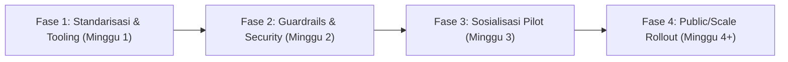

# 📋 BLUEPRINT STRATEGI & SOSIALISASI OTOMASI DEPLOYMENT COOLIFY VIA AI AGENT
**Dokumen Pengambilan Keputusan & Roadmap Teknis Proxsis Group**  
*Penulis: Rn (Cloud & AI Infra Team) | Reviewer: Mas Ulul | Target Audiens: Management & All End-Users*

---

## 1. BACKGROUND & PROBLEM STATEMENT (Kondisi Lapangan Saat Ini)

### A. Kondisi Lapangan & Problem Mba Fahima (Root Cause)
1. **Ambisi & Desain Awal:**
   - Tim Infra telah berhasil membuat pipeline otomatis: AI Agent membaca `AI_DEPLOYMENT_CONFIG.md`, mengeksekusi API Coolify & GitHub, dan aplikasi langsung online di `https://*.connect.proxsis.com` tanpa setting Caddyfile manual.
2. **Kendala Nyata (Kasus Mba Fahima):**
   - Mba Fahima menggunakan **Claude Desktop (Aplikasi GUI)**.
   - **Root Cause:** Claude Desktop secara native *hanya ruang percakapan (GUI)* yang tidak memiliki kapabilitas menjalankan terminal/shell/bash command di laptop pengguna (terisolasi sandbox). Akibatnya, saat AI memberikan instruksi eksekusi `curl` ke Coolify API, Claude Desktop tidak bisa mengeksekusinya secara mandiri, membuat user non-teknis kebingungan ("harus paste ke mana?").
   - Begitu diarahkan menggunakan **Google Antigravity**, deployment langsung berjalan lancar (*"sung bisa"*) karena Antigravity memiliki native tool execution (`run_command`) di sistem lokal.

---

## 2. KEPUTUSAN STANDARDISASI AI AGENT (Tiering Support)

Untuk mencegah tim Rn "habis waktu" melayani troubleshoot ratusan variasi tools pengguna, Proxsis menetapkan **Matriks Dukungan Resmi (Tiering)**:

| Tier | AI Tool / Platform | Tipe Interface | Status Dukungan | Rekomendasi Penggunaan |
| :--- | :--- | :--- | :--- | :--- |
| **Tier 1 (Official / Primary)** | **Google Antigravity** | Agentic CLI & IDE | **FULL SUPPORT** *(Recommended)* | Standar default internal. Zero-config, native bash execution, error self-healing. |
| **Tier 1 (Official / Secondary)** | **Claude Code (CLI)** | Terminal CLI (`claude`) | **FULL SUPPORT** | Alternatif utama bagi user yang sudah berlangganan Claude Pro/Team. |
| **Tier 1 (Developer Devs)** | **VS Code + Kilo Code / Cline / Roo** | IDE Extension | **FULL SUPPORT** | Khusus developer (seperti demo Pak Ronny). Native terminal permission. |
| **Tier 2 (Alternative / Non-CLI)** | **Claude Desktop + Custom MCP** | GUI + Local MCP Server | **COMMUNITY / BEST-EFFORT** | Butuh install MCP server per user (lebih kompleks di setup awal). |
| **Tier 3 (Unsupported)** | **Claude Desktop Polosan / ChatGPT Web** | Web / Isolated GUI | **NOT SUPPORTED** | Dilarang untuk flow deployment otomatis karena ketiadaan hak akses terminal. |

### 💡 Keputusan Kebijakan untuk Kasus Claude:
> **Kebijakan Tim:** Jangan memaksakan Claude Desktop polosan! Jika ada user yang terbiasa dengan akun Claude, tim Infra **mengarahkan user menginstall Claude Code CLI** (`npm install -g @anthropic-ai/claude-code`) dan login dengan akun Claude yang sama. Flow eksekusi dijamin 100% identik dengan Antigravity.

---

## 3. IDENTIFIKASI CONCERN & RESIKO (Jika Dibuka ke Publik / Lintas Tim Proxsis)

Jika infrastruktur Coolify ini dibuka ke publik atau lintas divisi (marketing, konsultan, magang, dev eksternal), ada 5 concern krusial yang **wajib dimitigasi**:

```
                  ┌───────────────────────────────────────────────┐
                  │ 5 CONCERN UTAMA PENGGUNAAN COOLIFY PUBLIK/TIM │
                  └──────────────────────┬────────────────────────┘
         ┌──────────────────┬────────────┴───────┬──────────────────┬─────────────────┐
         ▼                  ▼                    ▼                  ▼                 ▼
   1. Keamanan Token   2. Domain Clash     3. Resource Hog    4. Network/WAF     5. Human Error
   (Token Admin Bocor) (Tabrakan Subdomain)(Server Jebol)     (Cloudflare Blok)  (Hapus Project)
```

### 1. Keamanan Kredensial & Token Leakage (CRITICAL 🔴)
- **Problem Saat Ini:** Token Coolify (`COOLIFY_TOKEN`) yang dibagikan memiliki privilege tinggi. Jika token ditaruh di file markdown lokal dan repo di-push publik, token bocor. User juga berpotensi melihat atau menghapus container milik divisi lain.
- **Solusi:**
  - *Short-term:* Batasi token per Team/Project di Coolify (RBAC).
  - *Mid-term:* Buat **Deploy-Gateway Proxsis (Lightweight Webhook/CLI Proxy)**. User tidak diberi `COOLIFY_TOKEN` mentah, melainkan single-use session token atau via Proxsis SSO.

### 2. Tabrakan Nama Subdomain (Domain Collision) (HIGH 🟠)
- **Problem:** Jika 2 pengguna mengetik `SUBDOMAIN="landing"` atau `SUBDOMAIN="app"`, Traefik / Coolify akan error atau salah routing traffic.
- **Solusi Enforced Standard:**
  Format domain WAJIB menggunakan format:
  `https://[divisi]-[nama_user]-[namaproject].connect.proxsis.com`
  *(Contoh: `biztech-fahima-status.connect.proxsis.com`)*. Script AI Agent wajib mengautomasi penamaan ini.

### 3. Resource Sprawl & Storage Exhaustion (HIGH 🟠)
- **Problem:** User mencoba ratusan kali, membuat puluhan build container zombie yang tidak dipakai. RAM VM Proxmox (192.168.10.21) dan disk space Docker bisa penuh dalam seminggu.
- **Solusi:**
  - Terapkan **Auto-Prune Cron Job** di Coolify (hapus unused Docker images setiap malam).
  - Tetapkan kebijakan batas RAM per container (default limit: 512MB - 1GB RAM per app).
  - Terapkan Auto-TTL / Cleanup untuk sandbox/testing (contoh: container otomatis stop setelah 7 hari tidak aktif).

### 4. Cloudflare WAF & Network Whitelist (MEDIUM 🟡)
- **Problem:** Request API Coolify membutuhkan `-H "User-Agent: curl/8.5.0"` untuk bypass WAF Cloudflare. Jika user memakai script custom/bahasa lain tanpa header ini, request akan di-block (HTTP 403).
- **Solusi:** Bungkus flow menjadi 1 executable CLI helper script (misal: `proxsis-deploy`).

### 5. Multi-tenancy & Isolasi Lingkungan (MEDIUM 🟡)
- **Problem:** Aplikasi produksi bercampur dengan aplikasi percobaan internal.
- **Solusi:** Pisahkan Project Coolify menjadi minimal 2:
  - `Sandbox & R&D` (bebas coba-coba, auto-prune aktif).
  - `Internal Production` (hanya admin/lead dev yang bisa deploy).

---

## 4. ACTION PLAN & STEP-BY-STEP ROADMAP



### 📍 FASE 1: Standarisasi & Penyederhanaan Tooling (Minggu 1)
- [ ] **Rilis SOP Pilihan AI Agent:**
  - Rekomendasi 1: Google Antigravity (Zero config, tinggal pakai).
  - Rekomendasi 2: Claude Code CLI (bagi pemegang akun Claude).
  - Rekomendasi 3: VS Code + Kilo Code (bagi developer).
- [ ] **Sediakan 1-Line Installer:**
  Buat script automasi setup di laptop user agar tidak perlu install manual satu-persatu:
  `curl -fsSL https://connect.proxsis.com/setup-agent.sh | bash`
- [ ] **Perbarui Panduan AI (`AI_DEPLOYMENT_CONFIG.md`):**
  Sertakan mekanisme penamaan subdomain otomatis berbasis prefix pengguna agar tidak tabrakan.

### 📍 FASE 2: Security & Infra Guardrails (Minggu 2)
- [ ] **Setup Project Hierarchy di Coolify:**
  - Buat Environment terpisah: `Sandbox` vs `Production`.
- [ ] **Pasang Resource Limiter di Coolify:**
  - Limit CPU 0.5 core dan Memory 512MB untuk tiap container testing.
- [ ] **Docker Garbage Collection Automation:**
  - Pasang cron job pembersih image gantung (`docker image prune -af --filter "until=72h"`).

### 📍 FASE 3: Sosialisasi & Pilot Project (Minggu 3)
- [ ] **Pilot Class (Uji Coba Terbatas):**
  - Libatkan perwakilan non-tech (Mba Fahima), tech lead (Pak Ronny), dan dev tim.
  - Dokumentasikan feedback: Di menit ke berapa mereka bingung? Apakah ada error terminal?
- [ ] **Sediakan Cheat-Sheet "3 Langkah Deploy":**
  1. Buka folder proyek di Antigravity / Claude Code.
  2. Ketik: *"Deploy proyek ini ke Coolify"*.
  3. Tunggu link `*.connect.proxsis.com` muncul.

### 📍 FASE 4: Scaling & Public/Open Adoption (Minggu 4+)
- [ ] **Evaluasi Deploy-Gateway API:**
  - Jika pengguna di luar tim internal ingin deploy, buatkan portal web sederhana atau Discord/Slack bot yang bertindak sebagai jembatan, sehingga token Coolify internal tidak pernah dibagikan ke publik.
- [ ] **Audit Biaya & Kapasitas Server:**
  - Monitoring utilisasi VM Sitkrop Infra (192.168.10.21) via Prometheus/Grafana atau dashboard Coolify.

---

## 5. DRAFT JAWABAN LANGSUNG KE MAS ULUL (Bisa Di-copas oleh Rn)

```text
Siap Mas Ulul, ini hasil analisa dan keputusan solusinya setelah kita bedah:

1. KEPUTUSAN SUPPORT AGENT:
Kita fix tetapkan standard resmi:
- Tier 1 (Utama): Google Antigravity & Claude Code (CLI).
- Tier Developer: VS Code + Kilo Code (seperti yg didemokan Pak Ronny).
- Claude Desktop polosan kita coret/tidak di-support untuk flow ini, karena Claude Desktop murni GUI sandbox tanpa terminal execution. User Claude dialihkan pakai 'Claude Code CLI' (pakai akun Claude yg sama).

2. CONCERN UTAMA JIKA DIGUNAKAN PUBLIC / LINTAS TIM:
- Token Security: Token Coolify jangan dibagi mentah jika mau dipakai publik (rawan hapus project lain).
- Subdomain Collision: Wajib format [user]-[project].connect.proxsis.com biar gak bentrok.
- Server Resource (Sitkrop Infra): Wajib auto-cleanup docker image dan limit RAM 512MB per app agar VM Proxmox tidak jebol oleh project uji coba zombie.
- Cloudflare WAF: Header curl harus konsisten agar tidak di-403 Cloudflare.

3. ACTION PLAN:
- Minggu 1: Kunci template instruksi AI, sediakan 1-line script onboarding agent.
- Minggu 2: Setting resource limit & auto-prune di Coolify server.
- Minggu 3: Sosialisasi pilot run ke Mba Fahima & tim Pak Ronny.

Dokumen detail & roadmap lengkap sudah saya buatkan di notebook/project 'STRATEGI_SOSIALISASI_COOLIFY_AI.md'.
```
